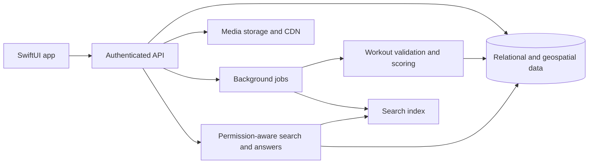

# Umbasa

**Make your move. Turn everyday fitness into local competition, connection, and discovery.**

Umbasa is a native SwiftUI fitness app prototype that brings territory competition, venue crowns, crews, athlete profiles, and community discovery into one experience. The ambition is to make your city feel like a shared playground—and give every workout a reason to happen beyond the numbers.

> **Project status:** Interactive frontend demo. Most content is sample data, and many interactions use temporary local state. A production backend, verified workout recording, persistent accounts, and live AI are not implemented yet.

## Table of contents

- [Mission and objective](#mission-and-objective)
- [The experience](#the-experience)
- [What works today](#what-works-today)
- [Demo boundaries](#demo-boundaries)
- [Why choose Umbasa?](#why-choose-umbasa)
- [Run locally](#run-locally)
- [Technology and project structure](#technology-and-project-structure)
- [Roadmap](#roadmap)
- [How Umbasa can scale](#how-umbasa-can-scale)
- [Trust, fairness, and privacy](#trust-fairness-and-privacy)
- [How we will measure progress](#how-we-will-measure-progress)
- [Contributing and maintaining this README](#contributing-and-maintaining-this-readme)
- [License and attribution](#license-and-attribution)

## Mission and objective

Make movement more rewarding through friendly competition, visible progress, and real community.

Umbasa aims to connect three motivations:

1. **Move with purpose:** Train, explore, and work toward meaningful goals.
2. **Compete locally:** Claim territory, defend venues, and challenge friends individually or with a crew.
3. **Belong somewhere:** Share achievements, find activities, exchange gear advice, and represent your city.

The long-term objective is a trusted fitness community where running, cycling, and swimming each have appropriate ways to participate. Territory and crowns are virtual game achievements—not ownership of physical spaces.

## The experience

| Destination | What it brings together |
| --- | --- |
| **Home** | A social activity feed, an upcoming event, and search across the community. |
| **Territory** | Individual and crew map layers, local venues, and useful training amenities. |
| **King of the Hill** | Venue competition, conquered locations, challenges, and leaderboards. |
| **Crews** | Crew identity, rankings, member contributions, and city representation. |
| **Profile** | Athlete identity, social connections, posts, gear advice, and deeper performance insights. |

## What works today

### Home and Umbasa AI search

- Activity cards showcase workouts, territory changes, and achievements using sample content.
- The Sunset 5K Training Run demonstrates upcoming activity discovery and a local join state.
- **“Search or ask with Umbasa AI”** searches a demo catalog of events, people, followers, gear, companies, crews, and map areas.
- Suggested prompts introduce search without requiring users to know the available categories.
- Asking **“Who controls downtown Austin?”** displays a demo answer naming Maya as the individual controller and Front Desk Crew as the crew controller, with profile links.
- Result destinations include athlete profiles, crew details, event information, and location maps.

Search currently uses local keyword matching and a predefined territory-answer rule. It is not an AI model, semantic search service, or live ownership lookup.

### Maps, venues, and crews

- MapKit displays sample individual and crew territories around Austin.
- Venue markers and training amenities help demonstrate local discovery, including water, restrooms, and refueling stops.
- Venue screens present conquered and contested locations, recommendations, and rankings.
- Crew screens introduce collective identity and competition, with sample city rankings.
- The workout screen offers running, cycling, and swimming flows as UI concepts.

### Athlete profiles

- A dark, photo-led hero, prominent athlete name, social counts, and orange accents establish the profile’s visual identity.
- Users can select a profile photo and edit their display name, bio, favorite sport, and represented city locally.
- Crew affiliation and rivalry appear near the top, alongside compact sport/activity and territory/crown summaries.
- Three large icon tabs organize **Posts**, **Gear**, and **Metrics**.
- A plus menu creates demo posts or gear entries; newly added items appear in their respective tabs.
- Gear supports personal notes, including training recommendations, race-day restrictions, and fit tips. Notes can be added, edited, or cleared.
- Metrics include a selectable 4- or 12-week running-speed chart, equivalent pace, percentage comparisons, territory goals, crowned locations, and workout mix.
- Settings are accessible from the top right and group workout connections, social management, privacy information, and sign-out.

## Demo boundaries

| Area | Current behavior | Needed for a live product |
| --- | --- | --- |
| Accounts | Demo entry and an Apple sign-in UI flow | Server-side identity verification, sessions, account lifecycle, and authorization |
| Posts and gear | Local additions and editable notes | Durable storage, media uploads, synchronization, and moderation |
| Workout recording | Sport selection and recording UI; start actions are placeholders | GPS/HealthKit capture, permissions, background handling, and verified ingestion |
| Device connections | Simulated connection controls and sample statistics | Approved provider integrations, token handling, and deduplication |
| Territory and crowns | Sample polygons, standings, and demo ownership | Authoritative scoring rules, geospatial processing, and conflict resolution |
| Metrics | Illustrative history and calculated comparisons over demo values | Aggregations from validated workout records |
| Search | Local catalog and predefined answer behavior | Live indexing, permission-aware retrieval, and optional semantic/AI assistance |
| Privacy controls | Information and navigation scaffolding | Enforced visibility rules, route redaction, blocking, deletion, and export |

Local edits are not a durable account record and may reset when views are recreated or the app restarts. Search uses its own demo catalog; it does not automatically index newly created profile content. Sample facts across screens are illustrative and are not yet backed by one authoritative data model. Some secondary controls remain placeholders.

## Why choose Umbasa?

**Umbasa’s proposed advantage is the combination of local competition and a richer athlete community:** discover an event, compete for a place, understand your progress, and learn from someone’s gear choices within the same product.

### Positioning alongside INTVL

INTVL is an established product, not a blank feature checklist. Its official website describes running and cycling territory games, clubs, private friend lobbies, local battles, device syncing, and performance trends. These are shared competitive foundations, not exclusive Umbasa inventions. See [INTVL’s official product overview](https://www.intvl.com.au/) (reviewed October 25, 2026).

| Umbasa focus | Intended benefit | Evidence in this repository |
| --- | --- | --- |
| Territory plus venue crowns | Give both route-based exercise and place-based sports meaningful competition | Territory maps, venue screens, and swimming-oriented UI |
| Posts, gear, and metrics in one athlete identity | Make profiles useful for inspiration, practical advice, and progress | Three profile tabs and editable gear notes |
| Conversational community discovery | Answer questions about people, places, activities, and ownership together | Local search and the downtown-control demo |
| Individual and crew perspectives | Let athletes express personal progress and shared identity | Separate map modes, crew views, and rivalry summaries |
| Practical local discovery | Help athletes find useful places while planning activity | Amenity markers and location details |

These are reasons Umbasa could become a better fit for athletes seeking this combined experience. They are **product hypotheses**, not proof that Umbasa currently outperforms INTVL or that INTVL lacks comparable features. Reliability, community adoption, usability, and retention must validate the advantage before claiming superiority.

## Run locally

1. Clone or download this repository onto a Mac with Xcode.
2. Open [`umbasa.xcodeproj`](../umbasa.xcodeproj).
3. Select the `umbasa` app scheme and a compatible simulator or device.
4. Build and run with **⌘R**.
5. Choose **Explore the demo** on the onboarding screen.

**Toolchain note:** The checked-in project currently sets deployment targets to **27.0** and lists iOS, macOS, and visionOS platforms. Use an Xcode installation with the matching SDK and runtime support. Broad platform support has not been comprehensively validated. Lowering deployment targets requires an API availability review; it is not just a documentation change.

Physical-device builds may require your own signing team and bundle identifier. No backend credentials or AI API key are required for the demo. Map tiles may require connectivity. The Apple Watch recording option is a placeholder, not a shipping watch app.

### Suggested walkthrough

1. Search Home for `Who controls downtown Austin?`, `Find running events`, or `Shoes for practice`.
2. Explore individual and crew territories and open an amenity.
3. Browse venue competition and crew standings.
4. Edit a profile, add a post, and add gear with a personal note.
5. Switch between Posts, Gear, and Metrics; compare the chart’s time ranges.

## Technology and project structure

The current app uses **Swift**, **SwiftUI**, **MapKit**, **Swift Charts**, **PhotosUI**, and **AuthenticationServices**. Data is predominantly provided by `SampleData` and view-local state. There is no production API or database in this repository yet.

| File | Responsibility |
| --- | --- |
| [`MyApp.swift`](MyApp.swift) / [`ContentView.swift`](ContentView.swift) | App entry and onboarding gate |
| [`Onboarding.swift`](Onboarding.swift) | Product introduction and demo entry |
| [`AppNavigation.swift`](AppNavigation.swift) | Main destinations and navigation bar |
| [`Home.swift`](Home.swift) / [`HomeSearch.swift`](HomeSearch.swift) | Feed, upcoming activity, and demo discovery |
| [`Territory.swift`](Territory.swift) | Map layers, territory summaries, and amenities |
| [`KingOfTheHill.swift`](KingOfTheHill.swift) | Venue competition |
| [`LockerRoom.swift`](LockerRoom.swift) | Crew experience |
| [`Profile.swift`](Profile.swift) / [`ProfileInsights.swift`](ProfileInsights.swift) | Profile, posts, gear notes, settings, and analytics |
| [`RecordWorkout.swift`](RecordWorkout.swift) | Workout recording UI scaffold |
| [`AppModels.swift`](AppModels.swift) / [`SampleData.swift`](SampleData.swift) | Shared types and fixtures |

## Roadmap

### 1. Establish a usable MVP

- [ ] Define the first supported sport, geography, scoring rules, and release platforms.
- [ ] Implement authenticated accounts and persistent profiles.
- [ ] Record or import one supported workout source reliably.
- [ ] Validate activities and compute territory ownership on the server.
- [ ] Support friends and basic rankings with enforced visibility rules.
- [ ] Pilot with a small group and fix the core loop before expanding scope.

### 2. Connect the community

- [ ] Persist posts, media, gear, and notes across devices.
- [ ] Add event creation, invitations, attendance, and notifications.
- [ ] Implement crew membership, roles, contributions, and seasonal competition.
- [ ] Add reporting, blocking, moderation, and account deletion.
- [ ] Unify search, metrics, and map views around the same source of truth.

### 3. Deepen the experience

- [ ] Expand sport-specific venue crowns and verification.
- [ ] Add approved device integrations and duplicate-workout reconciliation.
- [ ] Make AI answers cite current, authorized app records.
- [ ] Improve accessibility, localization, offline behavior, and adaptive layouts.
- [ ] Explore venue partnerships, community challenges, and optional paid features without selling competitive advantage.

## How Umbasa can scale

The following is a proposed direction, not infrastructure already built or a committed vendor selection.

Start with a **modular backend and managed services**, keeping deployment and operational complexity small. Separate responsibilities in code before splitting them into independent services.

- **Data foundation:** Use stable identifiers and explicit relationships for athletes, friendships, crews, events, gear, workouts, venues, and claims. A relational database with geospatial support is a candidate.
- **Fair scoring:** Ingest workouts idempotently, preserve source attribution, and calculate ownership transactionally. Use a claim history so disputes and recalculations are explainable.
- **Map performance:** Query by viewport, simplify geometry by zoom level, and cache tiles or summaries. Avoid downloading an entire city’s raw geometry to every device.
- **Background processing:** Queue media processing, workout validation, search indexing, notifications, and analytics so they do not block the interface.
- **Media delivery:** Store photos outside the primary database, generate thumbnails, and serve them through a CDN with appropriate access controls.
- **Search and AI:** Begin with structured filters and full-text search. Add semantic retrieval when useful; answers must respect relationship and visibility permissions and identify their supporting records.
- **Growth:** Add pagination, incremental sync, measured caching, and database indexes first. Partition workloads by geography or season only when observed load justifies it.
- **Operations:** Establish backups, recovery drills, migrations, audit logs, error reporting, latency monitoring, and cost budgets before public launch.

## Trust, fairness, and privacy

A live fitness community needs trust as part of the product:

- Hide sensitive route endpoints and support private activities and profiles.
- Request location and health permissions only when the relevant feature needs them.
- Validate implausible activity, duplicate imports, and simultaneous claims; offer a review path for disputed results.
- Design sport-specific rules so different activities compete fairly.
- Avoid challenges that encourage trespassing, unsafe routes, or excessive training.
- Enforce access rules on the backend, including for AI retrieval—not just in the interface.
- Provide clear data retention, export, deletion, reporting, and blocking controls.

These are launch requirements and design goals; the demo does not yet enforce them end to end.

## How we will measure progress

Success should mean people build sustainable habits and useful connections—not simply spend longer in the app. Proposed measures include:

- Completion of a first verified workout and successful territory update.
- Weekly active athletes, repeat activity, and pilot retention.
- Event participation and meaningful friend or crew interactions.
- Search success and the accuracy of ownership answers.
- Scoring disputes, crash-free sessions, battery impact, and sync reliability.
- Accessibility task completion and user-reported clarity of the game rules.

No production user counts, growth claims, or benchmark results are asserted here.

## Contributing and maintaining this README

Keep changes focused, document user-visible behavior, and distinguish sample interactions from live functionality. Build the app after code changes; add meaningful Swift Testing coverage for domain logic and UI automation for important flows as the product matures.

For bug reports, include the platform, steps to reproduce, expected behavior, and screenshots where helpful. Do not include credentials, private routes, or health records.

Update this README whenever a feature moves from demo to persistent functionality, setup requirements change, integrations become real, or the roadmap changes. Keep competitive comparisons sourced and dated. Add app screenshots once representative captures are available in the repository.

## License and attribution

No license is declared in this README. Add a repository license before offering reuse rights or describing the project as open source. Public GitHub visibility alone does not grant those rights.

Apple platform names and third-party brands belong to their respective owners. Demo product names and competitor references do not imply affiliation or endorsement.

---

**Last updated:** October 25, 2026 · Living documentation for the current Umbasa prototype.
