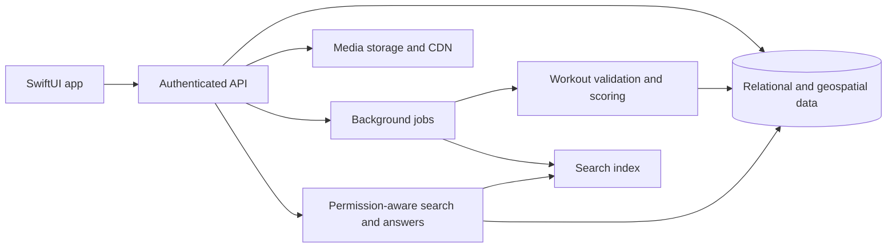

# Umbasa

**Make your move. Turn everyday fitness into local competition, connection, and discovery.**

Umbasa is a native SwiftUI fitness app prototype that brings territory competition, venue crowns, crews, athlete profiles, and community discovery into one experience. The ambition is to make your city feel like a shared playground—and give every workout a reason to happen beyond the numbers.

> **Project status:** Interactive frontend demo. Most content is sample data, and many interactions use temporary local state. A production backend, verified workout recording, persistent accounts, and live AI are not implemented yet.

## Table of contents

- [Mission and objective](#mission-and-objective)
- [The experience](#the-experience)
- [What works today](#what-works-today)
  - [Onboarding and login](#onboarding-and-login)
  - [Home](#home)
  - [Umbasa AI search](#umbasa-ai-search)
  - [Territory map](#territory-map)
  - [King of the Hill](#king-of-the-hill)
  - [Locker Room](#locker-room)
  - [Profile](#profile)
  - [Profile — Posts](#profile--posts)
  - [Profile — Gear](#profile--gear)
  - [Profile — Metrics](#profile--metrics)
  - [Settings and workout connections](#settings-and-workout-connections)
  - [Record workout](#record-workout)
- [Demo boundaries](#demo-boundaries)
- [Why choose Umbasa?](#why-choose-umbasa)
- [Run locally](#run-locally)
- [Technology and project structure](#technology-and-project-structure)
- [Personalized intelligence and connected agents](#personalized-intelligence-and-connected-agents)
  - [From keywords to meaning](#from-keywords-to-meaning)
  - [Agents that connect the experience](#agents-that-connect-the-experience)
  - [Premium agents for everyday athletic life](#premium-agents-for-everyday-athletic-life)
  - [Gear memory and replenishment](#gear-memory-and-replenishment)
  - [From recommendation to approved action](#from-recommendation-to-approved-action)
- [A sports hub that creates local stars](#a-sports-hub-that-creates-local-stars)
  - [Seasons worth winning](#seasons-worth-winning)
  - [Recognition, scouting, and athlete opportunity](#recognition-scouting-and-athlete-opportunity)
  - [Portable metrics and athlete portfolios](#portable-metrics-and-athlete-portfolios)
  - [Viewership and the commercial opportunity](#viewership-and-the-commercial-opportunity)
- [Roadmap](#roadmap)
- [How Umbasa can scale](#how-umbasa-can-scale)
- [Trust, fairness, and privacy](#trust-fairness-and-privacy)
- [How we will measure progress](#how-we-will-measure-progress)
- [Contributing and maintaining this README](#contributing-and-maintaining-this-readme)
- [License and attribution](#license-and-attribution)

## Mission and objective

Make movement more rewarding through friendly competition, visible progress, and real community.

Umbasa aims to connect three motivations:

1. **Move with purpose:** Train, explore, and work toward meaningful goals.
2. **Compete locally:** Claim territory, defend venues, and challenge friends individually or with a crew.
3. **Belong somewhere:** Share achievements, find activities, exchange gear advice, and represent your city.

The long-term objective is a trusted fitness community where running, cycling, and swimming each have appropriate ways to participate. Territory and crowns are virtual game achievements—not ownership of physical spaces.

## The experience

| Destination | What it brings together |
| --- | --- |
| **Home** | A social activity feed, an upcoming event, and search across the community. |
| **Territory** | Individual and crew map layers, local venues, and useful training amenities. |
| **King of the Hill** | Venue competition, conquered locations, challenges, and leaderboards. |
| **Locker Room** | Crew identity, rankings, member contributions, and city representation. |
| **Profile** | Athlete identity, social connections, posts, gear advice, and deeper performance insights. |

## What works today

Onboarding, search, settings, and recording are supporting screens; Home, Territory, King of the Hill, Locker Room, and Profile are the main destinations.

---

### Onboarding and login

**First impressions and entry into Umbasa.**

A futuristic Umbasa wordmark and orange accents introduce the app. A subdued city grid shows competing territories and exercise figures while keeping descriptions and buttons readable. Apple sign-in and **Explore the demo** remain available; demo entry does not create an account.

---

### Home

**Your community’s activity, at a glance.**

The feed shows sample workouts, territory changes, and achievements. The Sunset 5K Training Run introduces upcoming activities with a local join state. Search sits at the top of the page.

---

### Umbasa AI search

**Discover people, activities, gear, and places from one search bar.**

**“Search or ask with Umbasa AI”** searches a local catalog of events, friends, followers, gear, companies, crews, and map areas. Suggested prompts make the demo easy to explore. Asking **“Who controls downtown Austin?”** returns Maya and Front Desk Crew, with profile links. Results can open athlete profiles, crew details, event information, and location maps.

This is keyword matching with a predefined ownership answer—not a live AI model or authoritative territory lookup.

---

### Territory map

**See the city through individual and crew competition.**

MapKit displays sample territory polygons around Austin. Switch between individual and crew layers to explore different standings. Venue markers and training amenities highlight water, restrooms, and refueling stops. The map also provides access to the workout recording interface.

---

### King of the Hill

**Compete for the places where you train.**

Venue screens organize conquered and contested locations, recommended challenges, and leaderboards. Running, cycling, and swimming locations demonstrate how local crowns can complement route-based territory competition.

---

### Locker Room

**Build a shared identity around your crew.**

Crew screens bring together crew identity, city rankings, member contributions, and territory scores. Explore crew details and compare sample standings across represented cities. Membership and competition remain demo experiences rather than server-backed records.

---

### Profile

**An athlete’s identity, community, and progress in one place.**

The dark photo hero, large name, social counts, and orange accents give profiles a distinctive identity. Users can edit their name, bio, favorite sport, represented city, and photo locally. Rivalry, crew affiliation, compact activity metrics, territory, crowns, and the next activity appear above three large icon tabs. The plus menu offers a new post or gear entry.

---

### Profile — Posts

**Share the moments behind the workouts.**

A tiled collection displays demo posts with captions above their artwork. The plus menu opens the post composer, and published demo entries appear in the collection during the session.

---

### Profile — Gear

**Share what you use—and how you use it.**

Gear is organized into sport collections. Add equipment and write personal notes about practice, racing, sizing, or fit. Existing notes can be edited or cleared; newly added gear appears in the collection during the session.

---

### Profile — Metrics

**Go beyond a single workout summary.**

Favorite sport, rivalry, and crew context lead into a deeper metrics view. Demo insights include 4- and 12-week speed trends, equivalent pace, percentage changes, territory goals, crowned locations, training volume, and workout mix. These values illustrate the experience rather than measure a live account.

---

### Settings and workout connections

**Keep account management separate from the public profile.**

The top-right Settings entry groups workout connections, friends and crews, privacy information, and sign-out. Provider controls and imported statistics are simulated. Privacy information is scaffolding; production enforcement is still planned.

---

### Record workout

**The starting point for a future verified activity.**

The recording interface offers running, cycling, and swimming selections, with iPhone and Apple Watch recording concepts. Start actions are placeholders; GPS recording, HealthKit ingestion, and a shipping watch app are not implemented.

---

## Demo boundaries

| Area | Current behavior | Needed for a live product |
| --- | --- | --- |
| Accounts | Demo entry and an Apple sign-in UI flow | Server-side identity verification, sessions, account lifecycle, and authorization |
| Posts and gear | Local additions and editable notes | Durable storage, media uploads, synchronization, and moderation |
| Workout recording | Sport selection and recording UI; start actions are placeholders | GPS/HealthKit capture, permissions, background handling, and verified ingestion |
| Device connections | Simulated connection controls and sample statistics | Approved provider integrations, token handling, and deduplication |
| Territory and crowns | Sample polygons, standings, and demo ownership | Authoritative scoring rules, geospatial processing, and conflict resolution |
| Metrics | Illustrative history and calculated comparisons over demo values | Aggregations from validated workout records |
| Search | Local catalog and predefined answer behavior | Live indexing, permission-aware retrieval, and optional semantic/AI assistance |
| Privacy controls | Information and navigation scaffolding | Enforced visibility rules, route redaction, blocking, deletion, and export |

Local edits are not a durable account record and may reset when views are recreated or the app restarts. Search uses its own demo catalog; it does not automatically index newly created profile content. Sample facts across screens are illustrative and are not yet backed by one authoritative data model. Some secondary controls remain placeholders.

## Why choose Umbasa?

**Umbasa’s proposed advantage is the combination of local competition and a richer athlete community:** discover an event, compete for a place, understand your progress, and learn from someone’s gear choices within the same product.

### Positioning alongside INTVL

INTVL is an established product, not a blank feature checklist. Its official website describes running and cycling territory games, clubs, private friend lobbies, local battles, device syncing, and performance trends. These are shared competitive foundations, not exclusive Umbasa inventions. See [INTVL’s official product overview](https://www.intvl.com.au/) (reviewed October 25, 2026).

| Umbasa focus | Intended benefit | Evidence in this repository |
| --- | --- | --- |
| Territory plus venue crowns | Give both route-based exercise and place-based sports meaningful competition | Territory maps, venue screens, and swimming-oriented UI |
| Posts, gear, and metrics in one athlete identity | Make profiles useful for inspiration, practical advice, and progress | Three profile tabs and editable gear notes |
| Conversational community discovery | Answer questions about people, places, activities, and ownership together | Local search and the downtown-control demo |
| Individual and crew perspectives | Let athletes express personal progress and shared identity | Separate map modes, crew views, and rivalry summaries |
| Practical local discovery | Help athletes find useful places while planning activity | Amenity markers and location details |

These are reasons Umbasa could become a better fit for athletes seeking this combined experience. They are **product hypotheses**, not proof that Umbasa currently outperforms INTVL or that INTVL lacks comparable features. Reliability, community adoption, usability, and retention must validate the advantage before claiming superiority.

## Run locally

1. Clone or download this repository onto a Mac with Xcode.
2. Open [`umbasa.xcodeproj`](../umbasa.xcodeproj).
3. Select the `umbasa` app scheme and a compatible simulator or device.
4. Build and run with **⌘R**.
5. Choose **Explore the demo** on the onboarding screen.

**Toolchain note:** The checked-in project currently sets deployment targets to **27.0** and lists iOS, macOS, and visionOS platforms. Use an Xcode installation with the matching SDK and runtime support. Broad platform support has not been comprehensively validated. Lowering deployment targets requires an API availability review; it is not just a documentation change.

Physical-device builds may require your own signing team and bundle identifier. No backend credentials or AI API key are required for the demo. Map tiles may require connectivity. The Apple Watch recording option is a placeholder, not a shipping watch app.

### Suggested walkthrough

1. Search Home for `Who controls downtown Austin?`, `Find running events`, or `Shoes for practice`.
2. Explore individual and crew territories and open an amenity.
3. Browse venue competition and crew standings.
4. Edit a profile, add a post, and add gear with a personal note.
5. Switch between Posts, Gear, and Metrics; compare the chart’s time ranges.

## Technology and project structure

The current app uses **Swift**, **SwiftUI**, **MapKit**, **Swift Charts**, **PhotosUI**, and **AuthenticationServices**. Data is predominantly provided by `SampleData` and view-local state. There is no production API or database in this repository yet.

| File | Responsibility |
| --- | --- |
| [`MyApp.swift`](MyApp.swift) / [`ContentView.swift`](ContentView.swift) | App entry and onboarding gate |
| [`Onboarding.swift`](Onboarding.swift) | Product introduction and demo entry |
| [`AppNavigation.swift`](AppNavigation.swift) | Main destinations and navigation bar |
| [`Home.swift`](Home.swift) / [`HomeSearch.swift`](HomeSearch.swift) | Feed, upcoming activity, and demo discovery |
| [`Territory.swift`](Territory.swift) | Map layers, territory summaries, and amenities |
| [`KingOfTheHill.swift`](KingOfTheHill.swift) | Venue competition |
| [`LockerRoom.swift`](LockerRoom.swift) | Crew experience |
| [`Profile.swift`](Profile.swift) / [`ProfileInsights.swift`](ProfileInsights.swift) | Profile, posts, gear notes, settings, and analytics |
| [`RecordWorkout.swift`](RecordWorkout.swift) | Workout recording UI scaffold |
| [`AppModels.swift`](AppModels.swift) / [`SampleData.swift`](SampleData.swift) | Shared types and fixtures |

## Personalized intelligence and connected agents

**The vision: an assistant that understands your athletic world and can help you act on it.**

Umbasa AI should grow from answering questions into a personalized companion for discovery, planning, and practical tasks. Its context could include the sports you choose, your goals, preferred locations, crew, schedule, equipment, and the information you explicitly allow it to remember.

This is a future product direction. Today’s search is a local demo; the app does not yet run personalized agents, connect external accounts, organize real events, or place orders.

### From keywords to meaning

A semantic model would help interpret intent and relationships rather than depend on exact keywords. Umbasa’s underlying data would connect athletes, workouts, territories, venues, crews, events, and gear so that an answer can explain who, where, when, and why.

For example, **“Who controls downtown Austin?”** should identify the relevant area, distinguish individual from crew control, check current season standings, and explain which controllers are on your friends list. The response should link to the records behind it and show when they were updated.

Other questions could include:

- “Which friends are training for a 5K near me?”
- “How has my pace changed since the beginning of the season?”
- “What shoes does the city’s running champion use for practice versus racing?”
- “Which swimming events fit my schedule this weekend?”
- “What would I need to improve to challenge the leader at this venue?”

Semantic interpretation helps find the right information; verified records and explicit calculations should determine standings, ownership, and performance figures. If information is missing or outdated, the assistant should say so.

### Agents that connect the experience

A personalized agent could combine Umbasa context with authorized external services through **Model Context Protocol (MCP) connectors** or direct APIs. In this proposed design, connectors would expose specific capabilities—such as finding events, preparing a post, or looking up a product—to the agent.

MCP is an integration approach, not a promise that every named service offers an official connector or permits every action. Each connection would require an available, authorized integration and the appropriate user permissions.

| Use case | Example request | Proposed experience |
| --- | --- | --- |
| Community answers | “Who controls downtown Austin?” | Retrieve current individual and crew standings, highlight friends, and link to supporting records. |
| Event discovery | “Find a local 5K my crew could join.” | Combine Umbasa activity with authorized event sources such as Eventbrite and show relevant options. |
| Event organization | “Help organize a Saturday training run.” | Draft the location, schedule, attendance details, and invitations; prepare external event listings where supported. |
| Social coordination | “Share our crew’s season celebration.” | Prepare a recap and an Instagram-ready post, with publishing available only through supported account integrations. |
| Gear discovery | “Find the shoes this champion races in, in my size.” | Use athlete gear notes and authorized retailer information to compare products, availability, and prices. |
| Shopping | “Help me order these from Nike or Amazon.” | Prepare a cart or merchant checkout where supported, then let the user review the exact purchase. |
| Coaching and records | “Send my season progress to my coach.” | Prepare a permission-controlled report or export containing the selected metrics and period. |

### Premium agents for everyday athletic life

Personalized agents could become an **optional premium feature**: an ongoing service that helps athletes interpret their data, plan their next move, and manage routine tasks. Potential value includes deeper personalization, proactive briefings, connected planning, and user-approved automations. Pricing, usage limits, and the division between free and paid features remain open product decisions.

The agent should remember preferences the user chooses to share, explain its suggestions, and adapt when those preferences change. It should save attention and effort, not require athletes to continually search, refresh the feed, or inspect every update.

| Capability | Proposed experience |
| --- | --- |
| Tailored exercise guidance | Combine goals, recent workouts, available time, equipment, and user feedback to suggest sessions and areas to work on, such as consistency, endurance, or strength. |
| Recovery-aware planning | Consider recent training load, reported fatigue, and available recovery information before suggesting another demanding session. Explain when a rest day or lighter activity may fit better. |
| Event timing and selection | Rank events by interests, location, schedule, preparation, and recovery needs—not simply by popularity or proximity. Offer a later event or a spectator option when participation may conflict with recovery. |
| Proactive highlights | Deliver a concise daily or weekly briefing of relevant territory changes, rivalries, crew achievements, upcoming events, and personal progress, with links to the underlying records. |
| Personalized gear discovery | Match suggestions to user-stated fit, support preferences, budget, sport, training purpose, and previous experiences rather than recommend whatever is trending. |
| Gear release alerts | Watch authorized product sources for new versions of equipment the athlete already uses and explain relevant changes, availability, and whether an upgrade fits their stated needs. |
| Consumable replenishment | Help set up an optional recurring order for a favorite gel or other frequently purchased item, with user-defined product, quantity, cadence, and spending limits. |

For example, a briefing could say: **“Your crew gained two blocks, your next event is Saturday, and you reported fatigue after your last two sessions. Consider an easier day today.”** The goal is useful context delivered at the right time, with user-controlled frequency and quiet hours.

Training and recovery suggestions would be estimates based on the information available, not diagnoses or guarantees that an activity is safe. The agent should identify missing data, respect athlete and coach input, and avoid presenting a calculated score as certainty about someone’s readiness.

### Gear memory and replenishment

Gear recommendations should reflect the individual. If a user reports overpronation and says they prefer or have been advised to use stability shoes, the agent should preserve that context when comparing options instead of defaulting to a popular neutral shoe. A comparison such as **New Balance 860 versus 1080** illustrates the intended personalization: verify the current models’ specifications, explain how each aligns with the user’s stated support and fit requirements, and leave the choice with the athlete. This is a future comparison workflow, not a medical assessment or a current product recommendation.

The same memory could distinguish race shoes from daily trainers, retain preferred gel flavors, remember sizes, and exclude products the user disliked. Release alerts should explain what changed rather than assume every new model is a necessary purchase.

For repeat purchases, an agent could help establish a supported merchant subscription or a bounded reorder authorization. The athlete would approve the exact item, merchant, quantity, frequency, price ceiling, and payment arrangement in advance. Routine orders could then follow that authorization where the merchant supports it, with notices and simple pause, skip, and cancellation controls. Substitutions, price increases beyond the approved limit, or changes to the order terms would require renewed review.

Subscriptions must be explicitly enabled; purchase history alone is not permission to reorder. Payment availability and recurring-charge support depend on the merchant and payment provider. Gear preferences and replenishment rules should be editable and separate from sponsored recommendations.

### From recommendation to approved action

The intended flow is **understand → retrieve → propose → review → act → confirm**.

The agent could do the preparation, but the user would review consequential actions: publishing a post, inviting people, registering for a paid event, sharing private metrics, or placing a one-time order. Recurring purchases would follow the explicit, bounded authorization described above; actions outside those terms would require renewed approval. Purchase review should include the merchant, product, size, quantity, total cost, delivery details, and applicable return information.

Where a supported merchant checkout offers **Apple Pay** or another payment method, Umbasa could hand off to that checkout and its user authorization flow. The assistant would not need raw payment credentials or unrestricted purchasing authority. Failed requests and retries must not create duplicate orders, registrations, or posts.

Personalization should remain controllable: users can inspect remembered preferences, revoke connections, and choose what an agent may access. Public athlete information, private training data, and commercial recommendations should remain clearly distinguished.

## A sports hub that creates local stars

**Umbasa’s ambition is to make exceptional local athletes visible—and give their achievements a stage.**

A season championship should feel bigger than a number on a leaderboard. Taking over a city, defending multiple venues, or winning a sport’s season represents commitment and a story worth celebrating. Umbasa could become a place where everyday athletes build a following, earn recognition, and turn sustained performance into new opportunities.

### Seasons worth winning

Imagine a runner finishing the season as **King of New York City**, a cyclist winning across multiple cities, or a swimmer becoming the season champion at the community’s most competitive venues. Each achievement could become a lasting part of that athlete’s identity.

The proposed championship experience could include:

- Sport-specific city titles and venue crowns tied to a clearly defined season.
- Verified winner profiles, achievement histories, and shareable season recaps.
- Highlights showing decisive workouts, rivalries, crew contributions, and progress.
- Community celebrations, local events, and recognition for emerging athletes.
- A permanent record of past champions, even as a new season begins.

Titles would need published qualification and scoring rules. Territory control, training consistency, and competitive race performance measure different things; championship records should make that distinction clear.

### Recognition, scouting, and athlete opportunity

Umbasa could help coaches, clubs, event organizers, and brands discover athletes beyond established professional circuits. Athletes who opt in could present a verified record of their progress, performances, and achievements alongside their community presence.

A standout running champion might attract attention from a brand such as Nike. A swimming champion could become relevant to a brand such as Speedo. Those are examples of the opportunity we want to create—not existing partnerships or promised deals.

The goal is to make introductions and evaluation easier: an athlete’s season results, development, and audience can tell a richer story than a single post. Coaches and scouts would still need to assess performance in context; winning a territory game alone does not establish professional sporting ability.

### Portable metrics and athlete portfolios

Athletes should be able to take their records with them. Planned exports could include:

| Format | Intended use |
| --- | --- |
| CSV | Workout and season data for spreadsheets, personal records, or a coach’s analysis. |
| Spreadsheet-ready summaries | Organized tables of distances, pace or speed, training frequency, and changes over time. |
| PDF season reports | A readable portfolio of progress, verified achievements, and championship results. |
| Shareable athlete profiles | An athlete-controlled view for coaches, scouts, sponsors, or supporters. |

Exports should identify date ranges, units, sport, data sources, and verification status. They should distinguish raw measurements from derived metrics and let athletes omit sensitive details such as precise routes. Downloading or sharing useful records should be an intentional athlete action.

### Viewership and the commercial opportunity

As athletes and crews build stories across a season, Umbasa could become a destination for spectators as well as participants. People could follow local leaders, track rivalries, support a crew, and celebrate championship runs. Season recaps, standings, and athlete spotlights would give audiences reasons to return.

That attention creates several possible business models:

| Opportunity | How it could create value |
| --- | --- |
| Athlete sponsorships | Brands support relevant athletes, champions, and crews through clearly identified partnerships. |
| Sponsored seasons and events | Local businesses or larger brands fund competitions, celebrations, and prizes. |
| Advertising | Relevant placements help brands reach sporting communities without interrupting core training tasks. |
| Athlete gear influence | Athletes explain what they actually use; their gear collections can drive discovery and, where disclosed, affiliate purchases. |
| Brand and venue profiles | Companies and training locations participate through useful information, events, and community offers. |
| Optional premium tools and agents | Personalized training and recovery insights, proactive highlights, event planning, gear monitoring, and approved replenishment workflows could support a subscription offering. Packaging and pricing remain undecided. |

Gear collections can become a natural form of athlete-led promotion: a trusted champion’s recommendation may matter more than a generic advertisement. An ordinary gear note is not automatically an ad; paid placements, gifted equipment, sponsorships, and affiliate relationships should be identified clearly.

The ambition is a mutually useful ecosystem: athletes gain recognition and opportunities, fans gain local stories to follow, coaches discover talent, and brands connect with communities that actually use their products. Commercial partnerships must not buy championship results, alter verified rankings, or quietly determine an agent’s recommendations.

These are growth ambitions to validate through pilots and community demand. Sponsorships, scouting tools, exports, payments, advertising products, and spectator features are not implemented in the current prototype.

## Roadmap

### 1. Establish a usable MVP

- [ ] Define the first supported sport, geography, scoring rules, and release platforms.
- [ ] Implement authenticated accounts and persistent profiles.
- [ ] Record or import one supported workout source reliably.
- [ ] Validate activities and compute territory ownership on the server.
- [ ] Support friends and basic rankings with enforced visibility rules.
- [ ] Pilot with a small group and fix the core loop before expanding scope.

### 2. Connect the community

- [ ] Persist posts, media, gear, and notes across devices.
- [ ] Add event creation, invitations, attendance, and notifications.
- [ ] Implement crew membership, roles, contributions, and seasonal competition.
- [ ] Add reporting, blocking, moderation, and account deletion.
- [ ] Unify search, metrics, and map views around the same source of truth.

### 3. Deepen the experience

- [ ] Expand sport-specific venue crowns and verification.
- [ ] Add approved device integrations and duplicate-workout reconciliation.
- [ ] Make AI answers cite current, authorized app records.
- [ ] Improve accessibility, localization, offline behavior, and adaptive layouts.
- [ ] Explore venue partnerships, community challenges, and optional paid features without selling competitive advantage.

### 4. Build the athlete opportunity ecosystem

- [ ] Define verified seasonal titles, winner histories, and shareable championship recaps.
- [ ] Offer CSV exports, coach-ready reports, and athlete-controlled portfolios.
- [ ] Pilot opt-in discovery for coaches, clubs, scouts, and sponsors.
- [ ] Introduce spectator experiences and clearly disclosed commercial partnerships.
- [ ] Connect personalized agents to approved event, social, and retail services.
- [ ] Evaluate optional premium agents with user-controlled memory, briefings, and training or recovery suggestions.
- [ ] Pilot preference-aware gear comparisons, product release alerts, and explicitly authorized replenishment subscriptions.
- [ ] Add reviewed action flows for publishing, registrations, and supported merchant checkout.

## How Umbasa can scale

The following is a proposed direction, not infrastructure already built or a committed vendor selection.

Start with a **modular backend and managed services**, keeping deployment and operational complexity small. Separate responsibilities in code before splitting them into independent services.

- **Data foundation:** Use stable identifiers and explicit relationships for athletes, friendships, crews, events, gear, workouts, venues, and claims. A relational database with geospatial support is a candidate.
- **Fair scoring:** Ingest workouts idempotently, preserve source attribution, and calculate ownership transactionally. Use a claim history so disputes and recalculations are explainable.
- **Map performance:** Query by viewport, simplify geometry by zoom level, and cache tiles or summaries. Avoid downloading an entire city’s raw geometry to every device.
- **Background processing:** Queue media processing, workout validation, search indexing, notifications, and analytics so they do not block the interface.
- **Media delivery:** Store photos outside the primary database, generate thumbnails, and serve them through a CDN with appropriate access controls.
- **Search and AI:** Begin with structured filters and full-text search. Add semantic retrieval when useful; answers must respect relationship and visibility permissions and identify their supporting records.
- **Growth:** Add pagination, incremental sync, measured caching, and database indexes first. Partition workloads by geography or season only when observed load justifies it.
- **Operations:** Establish backups, recovery drills, migrations, audit logs, error reporting, latency monitoring, and cost budgets before public launch.

## Trust, fairness, and privacy

A live fitness community needs trust as part of the product:

- Hide sensitive route endpoints and support private activities and profiles.
- Request location and health permissions only when the relevant feature needs them.
- Validate implausible activity, duplicate imports, and simultaneous claims; offer a review path for disputed results.
- Design sport-specific rules so different activities compete fairly.
- Avoid challenges that encourage trespassing, unsafe routes, or excessive training.
- Enforce access rules on the backend, including for AI retrieval—not just in the interface.
- Provide clear data retention, export, deletion, reporting, and blocking controls.

These are launch requirements and design goals; the demo does not yet enforce them end to end.

## How we will measure progress

Success should mean people build sustainable habits and useful connections—not simply spend longer in the app. Proposed measures include:

- Completion of a first verified workout and successful territory update.
- Weekly active athletes, repeat activity, and pilot retention.
- Event participation and meaningful friend or crew interactions.
- Search success and the accuracy of ownership answers.
- Scoring disputes, crash-free sessions, battery impact, and sync reliability.
- Accessibility task completion and user-reported clarity of the game rules.

No production user counts, growth claims, or benchmark results are asserted here.

## Contributing and maintaining this README

Keep changes focused, document user-visible behavior, and distinguish sample interactions from live functionality. Build the app after code changes; add meaningful Swift Testing coverage for domain logic and UI automation for important flows as the product matures.

For bug reports, include the platform, steps to reproduce, expected behavior, and screenshots where helpful. Do not include credentials, private routes, or health records.

Update this README whenever a feature moves from demo to persistent functionality, setup requirements change, integrations become real, or the roadmap changes. Keep competitive comparisons sourced and dated.

## License and attribution

No license is declared in this README. Add a repository license before offering reuse rights or describing the project as open source. Public GitHub visibility alone does not grant those rights.

Apple platform names and third-party brands belong to their respective owners. Demo product names and competitor references do not imply affiliation or endorsement.

---

**Last updated:** October 25, 2026 · Living documentation for the current Umbasa prototype.
